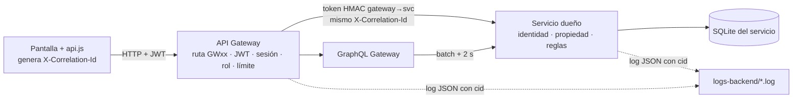

# Unidad 3 — Integración frontend–backend y validación basada en evidencias

**Caso:** Juguetería Ludiko (juguetes didácticos y lúdicos para niños). **Integrantes:** Bruno Martínez (Sección 8481) y Agustín Díaz — *completar sección y aportes (sección 7.2)*.

**Versión final evaluada:** código de la aplicación en el commit `fefbc19` (sin cambios en `frontend/`, `backend/` ni `tests/` desde entonces; los commits posteriores solo tocan documentación y evidencias); protocolo de pruebas «v1.3-ludiko» (el v1.3 del proyecto de origen con los literales de dominio adaptados). **Ejecuciones de la versión final:** `RUN-01` y `RUN-02` (independientes, cada una desde bases de datos nuevas).

> **Origen y declaración sobre quién ejecutó.** Este proyecto es la **adaptación a la temática de juguetes** del proyecto conjunto «Chocolatería Chocomanía» (https://github.com/b9ruci/DWM), cuya implementación y ejecuciones fueron realizadas con un agente automatizado (Claude Code) a pedido del equipo. La adaptación al dominio de juguetes (datos, textos, imágenes, paleta, literales de las pruebas), la corrección de la incidencia I-01 y las ejecuciones RUN-01, RUN-02 y CARGA-01 de **esta** versión también las realizó un agente automatizado (Claude Code) a pedido de Agustín Díaz, el 2026-11-09. Las evidencias de la versión de chocolatería **no** se reutilizan: todas las evidencias de este paquete fueron generadas sobre la versión de juguetes. El equipo debe revisar el expediente, re-ejecutar al menos una corrida con `node tests/runner.mjs --run RUN-03 --executor "Nombre"` y completar las secciones marcadas *completar*. Que quien implementó sea quien ejecutó es una amenaza a la validez (sección 6.4).

Regla central aplicada: **Requisito → criterio → prueba → ejecución → evidencia → conclusión**, materializada en [`docs/trazabilidad.csv`](trazabilidad.csv) y en una `FICHA.md` por prueba y ejecución (`evidencias/RUN-xx/Pyy/FICHA.md`).

---

## Etapa 1 — Línea base y alcance

### 1.1 Ficha del entorno y versiones

| Elemento | Valor |
|---|---|
| Línea base (inicio U3) | commit `2cb7127`: importación sin cambios del proyecto integrado «Chocolatería Chocomanía» (frontend PHP + backend de 9 servicios), con dominio ajeno a la temática de este repositorio (juguetes) |
| Versión final | aplicación `fefbc19` · protocolo v1.3-ludiko (mismo commit) · frontend v3.0.0 |
| Runtime | Node.js v22.23.4 (`node:sqlite`), PHP 8.3.6 (servidor embebido), graphql-js 16.11.0 |
| Navegador de prueba | Chromium 153.0.8010.12 (Playwright 1.63, headless) |
| Viewports | escritorio 1366×768; móvil **emulado** Pixel 7 (412×839, DPR 2,625, táctil); responsivo 360/768/1024/1440 px |
| SO | Linux 6.18 (contenedor cloud) |
| Configuración | sin secretos en el repositorio; `node backend/scripts/init-secrets.js` genera `.secrets/` (ignorado por git) |
| Migraciones / datos | `backend/services/*/migrations/*.sql` + semillas ficticias de juguetes (9 productos en 4 categorías: Construcción, Peluches, Puzzles, Arte; 4 promociones; 3 cuentas) |
| Cuentas por rol | `admin@ludiko.test` (ADMIN), `ana.cliente@…` (clienteA), `bruno.cliente@…` (clienteB); contraseñas aleatorias en `.secrets/seed-accounts.json` |
| Inicio | `node backend/scripts/start-local.js` (verificado) · `docker compose up --build` (no verificado, ver R14) |
| Restauración | `node backend/scripts/reset-data.js`; el arnés usa además una carpeta de datos nueva por ejecución |

### 1.2 Estado inicial de los flujos (línea base `2cb7127`)

| Flujo | Estado inicial | Problema conocido |
|---|---|---|
| Catálogo, carrusel, destacados | operan con datos reales de inventory, pero de **chocolatería** (barras, figuras, bombones) | no corresponde a la temática del repositorio (juguetes didácticos) |
| Login, carrito, pedidos, pagos, perfil, administración | operan de extremo a extremo contra los servicios reales | textos, nombres de cuentas y correos de dominio ajeno |
| Nosotros, Servicios, Contacto (canales) | leen `assets/data/*.json` | **los archivos no estaban versionados** en el origen (ver incidencia I-01) |
| Mockup | boceto de chocolatería | el mockup de este repositorio (Semana 4) es de juguetería |

### 1.3 Inventario de flujos (riesgo y prioridad)

| ID | Req. | Objetivo del usuario | Rol | Pantalla | Servicios / protocolo | Datos afectados | Criticidad (justificación) | Estado inicial | Dependencia externa | Criterios |
|---|---|---|---|---|---|---|---|---|---|---|
| F01 | R01 | ver y filtrar productos | visitante | catalogo.php | GW→inventory REST | lectura catálogo | **Alta** (puerta de venta; error = no hay ventas) | chocolatería | — | CA01–CA03, CA25 |
| F02 | R01 | ver promociones y destacados | visitante | index.php | GW→inventory REST | lectura | Media | local | — | CA30 |
| F03 | R02 | crear cuenta / ingresar | visitante | modal | GW→auth→clients | cuentas, perfil | Alta (identidad) | sin función | — | CA04, CA05, CA17 |
| F04 | R03 | confirmar pedido | CLIENTE | carrito.php | GW→orders→inventory | pedido, stock | **Crítica** (dinero y stock) | inexistente | — | CA06–CA09 |
| F05 | R04 | pagar | CLIENTE | pasarela, pedidos.php | GW→payments→proveedor; webhook | pago, estado del pedido | **Crítica** | inexistente | proveedor de pagos → **doble de prueba** | CA06, CA10, CA11, CA26 |
| F06 | R05 | ver mis pedidos | CLIENTE | pedidos.php | GW→GraphQL→orders+inventory+payments+clients | lectura PII | **Alta** (privacidad) | inexistente | — | CA12–CA15 |
| F07 | R06 | cancelar pedido | CLIENTE | pedidos.php | GW→orders→inventory | estado, stock | Media | inexistente | — | CA20 |
| F08 | R07 | mantener perfil | CLIENTE | perfil.php | GW→clients | PII cifrada | Media-alta (PII) | inexistente | — | CA21 |
| F09 | R08 | pedir orden especial | visitante | contacto.php | GW→clients | solicitud | Media | local | — | CA22, CA27 |
| F10 | R09 | administrar productos | ADMIN | admin.php | GW→inventory | catálogo | Alta (precios) | inexistente | — | CA23, CA18 |
| F11 | R10 | gestionar pedidos, resumen, clientes | ADMIN | admin.php | GW→orders, GraphQL, clients | estados, PII | Alta | inexistente | — | CA24, CA31, CA18 |
| F12 | R11 | control de acceso transversal | todos | — | gateway, auth, servicios, secrets | — | **Crítica** | inexistente | — | CA16–CA19, CA29 |

Requisitos R01–R14: ver `docs/unidad2-informe.md`. R12 (resiliencia), R13 (responsivo) y R14 (despliegue) son transversales.

### 1.4 Recorridos críticos seleccionados (validación profunda)

| ID | Recorrido | Cubre | Escenarios |
|---|---|---|---|
| **C1** | Consultar catálogo (lectura) | inventory | éxito P01 · límite P02 · fallo/recuperación P03 |
| **C2** | Comprar y pagar (cambio persistente de estado) | orders, inventory, payments | éxito P06 · rechazo/límite P07 · recuperación por reintento P08 · rechazo de pago y recuperación P10 |
| **C3** | Consultar pedidos propios vía GraphQL (acceso protegido) | orders, inventory, payments, clients | éxito P12 · recurso ajeno P13 · límites P14 · fallo de dependencia P15 |

Justificación: C2 concentra dinero, stock e integración externa; C3 concentra datos personales y la agregación; C1 es el flujo de mayor tráfico. Los demás flujos siguen en el alcance (P04–P05, P09, P11, P16–P31).

### 1.5 Clasificación de dependencias y componentes condicionales

| Componente | Tipo |
|---|---|
| API Gateway, Auth, administrador de secretos, GraphQL Gateway, inventory, orders, clients, payments, frontend | **reales** (propios, ejecutados en cada corrida) |
| Proveedor de pagos | **doble de prueba** declarado (`payment-sandbox`): limita las conclusiones al contrato simulado |
| Analítica y gRPC | **no aplican** — se mantiene ADR-001 (U2); revalidado con CARGA-01 |

Cambios de arquitectura respecto del diseño U2: ninguno en esta adaptación. Se heredan del origen: (1) dependencias de interfaz **autoalojadas** (Bootstrap, iconos y fuentes); (2) campo GraphQL `PaginaPedidos.pedidos`; (3) el gateway invalida su caché de sesión al cerrar sesión. Cambio de modelo de datos de esta adaptación: la unidad de venta `kg` se reemplazó por `pack` (migración `001_schema.sql`) y las categorías pasaron a Construcción, Peluches, Puzzles y Arte.

### 1.6 Recorrido de las solicitudes

### 1.7 Limitaciones iniciales

Sin demonio Docker en el entorno (compose no ejecutable); comunicación en loopback sin TLS; proveedor de pagos simulado; dispositivos móviles solo emulados; datos sintéticos pequeños.

---

## Etapa 2 — Criterios y protocolos

Las 32 fichas de prueba (identificación, precondiciones, procedimiento, resultado esperado, verificación y restauración) están **definidas en el código** antes de ejecutar (`tests/suites/*.mjs`) y se imprimen con el resultado en cada `FICHA.md`. Cada ficha separa el **esperado** de las **comprobaciones observadas**, que se registran antes de clasificar.

| Criterio | Enunciado observable (resumen) | Prueba |
|---|---|---|
| CA01 | La grilla muestra la misma cantidad de productos y precios que inventory, solo campos públicos | P01 |
| CA02 | Categoría filtra; búsqueda sin coincidencias muestra estado vacío; filtro inválido → 400 | P02 |
| CA03 | Con inventory caído: error comprensible con referencia, sin datos falsos; "Reintentar" recupera | P03 |
| CA04 | Registro desde UI; login independiente; hash scrypt; perfil con el mismo id | P04 |
| CA05 | Login inválido: mensaje genérico sin token; contraseña débil 400; duplicado 409 | P05 |
| CA06 | Compra: monto calculado por el servidor; UI confirma; consulta independiente PAGADO/APROBADO; stock −n; reserva CONFIRMADA | P06 |
| CA07 | Stock insuficiente: 409, sin pedido ni descuento | P07 |
| CA08 | Reintento tras respuesta perdida: misma clave, un solo pedido, stock una vez | P08 |
| CA09 | Precio/monto/estado del navegador no se aceptan | P09 |
| CA10 | Pago rechazado se informa y no paga el pedido; nuevo intento aprobado | P10 |
| CA11 | Notificación duplicada sin efecto; firma falsa 401 | P11 |
| CA12 | Pantalla de pedidos = orders; agregación de 4 subsistemas en la traza | P12 |
| CA13 | Pedido ajeno: UI "no encontrado" sin datos; 404 en ver/pagar/cancelar; sin cambios | P13 |
| CA14 | GraphQL: costo, introspección, campo restringido, rol, paginación y tamaño | P14 |
| CA15 | GraphQL con inventory caído: `completo=false`, advertencia visible, recuperación | P15 |
| CA16 | Sin sesión: 401 y la UI pide iniciar sesión; sin efectos | P16 |
| CA17 | Token expirado 401 y aviso en UI; token revocado rechazado **inmediatamente** | P17 |
| CA18 | Rol cliente en rutas admin: 403 y sin modificaciones | P18 |
| CA19 | Acceso directo a servicios/secretos sin identidad o fuera de ACL: rechazado | P19 |
| CA20 | Cancelar: estado CANCELADO, stock restaurado, historial conservado, 2ª cancelación 409 | P20 |
| CA21 | RUT con DV inválido rechazado por el servidor; datos persistidos y cifrados en reposo | P21 |
| CA22 | Orden especial desde "¡Contáctanos!"; validación UI y servidor; admin la ve | P22 |
| CA23 | Alta y baja lógica de producto reflejadas en catálogo público | P23 |
| CA24 | Transición válida desde UI admin; inválida 409; cliente ve el estado | P24 |
| CA25 | Demora de 5 s: corte en ≈4 s con mensaje (< 6 s) y recuperación | P25 |
| CA26 | Proveedor caído: mensaje, pedido sigue reservado, recuperación | P26 |
| CA27 | Límite de solicitudes: 429 + Retry-After, sin registros | P27 |
| CA28 | 4 anchos sin desborde; menú colapsado < 992 px; columnas 1/3/3/4 | P28 |
| CA29 | Evidencias y logs sin secretos ni JWT | P29 |
| CA30 | Carrusel y destacados = inventory; agregar desde el carrusel actualiza el contador | P30 |
| CA31 | KPI de pagados = referencia + 1; clientes enmascarados | P31 |
| CA32 | `docker compose up` levanta el sistema y solo publica 8000/8080/8090 | P32 (manual) |

**Verificación de datos:** consulta autorizada posterior en **sesión nueva** (cliente API) y/o lectura SQLite de **solo lectura** de la base del servicio dueño — independiente de la pantalla que ejecutó la acción.

**Rendimiento:** solo se concluye sobre lo medido en CARGA-01 (objetivo fijado antes: p95 < 300 ms, 0 % errores, 20 concurrentes). No hay conclusiones de rendimiento de escritura.

**Repeticiones e intermitencias (definido antes de resumir):** una prueba distinta se considera *aprobada* en una versión solo si aprueba en **ambas** ejecuciones independientes de esa versión; si falla en alguna, cuenta como *fallida* (intermitente) hasta que su causa se resuelva y se repitan dos ejecuciones.

**Versiones del protocolo:**

| Versión | Cambio | Motivo | Pruebas repetidas |
|---|---|---|---|
| v1.3 (origen) | protocolo del proyecto de chocolatería | — | — |
| v1.3-ludiko (`fefbc19`) | literales de dominio (nombres, precios, categorías, unidad «por pack») en P01, P02, P06–P08, P12, P20, P22, P23, P30 y P31; título esperado de la primera promoción en P30 | adaptación de dominio; en un ensayo de depuración P30 falló por un título esperado desactualizado (incidencia I-02) | todas (RUN-01, RUN-02) |

Los ensayos de depuración del arnés (ejecuciones `--scratch`) se hicieron fuera del paquete de evidencias y **no se conservaron**; por eso no se usan para ninguna conclusión. *Pendiente del equipo:* revisión cruzada del protocolo por un integrante distinto del autor.

---

## Etapa 3 — Integración incremental (bitácora)

| Inc. | Fecha | Versión | Flujo | Diferencia de contrato / problema encontrado | Cambio realizado | Prueba asociada | Estado | Siguiente acción |
|---|---|---|---|---|---|---|---|---|
| 0 | 2026-11-09 | `2cb7127` | todos | proyecto de origen con dominio de chocolatería | línea base registrada (importación sin cambios) | — | — | adaptar dominio |
| 1 | 2026-11-09 | `4f31ea6` | F01–F12 | dominio ajeno: productos, categorías (`Barras…`), unidad `kg`, textos, logo, paleta | semillas de juguetes; categorías Construcción/Peluches/Puzzles/Arte; unidad `pack`; imágenes SVG, logo y paleta celeste/amarilla; textos | ensayo de depuración | 30/31 | corregir literales |
| 2 | 2026-11-09 | `4f31ea6` | F02 | P30 esperaba el título largo del producto en el carrusel, que muestra el título de la promoción | literal de la prueba corregido (I-02) | P30 | OK | datos estáticos |
| 3 | 2026-11-09 | `4f31ea6` | Nosotros, Servicios, Contacto | `frontend/assets/data/` no existe en el origen por `.gitignore` (I-01) | JSON de equipo, servicios y canales de la juguetería; regla `/data/` anclada | verificación HTTP (200 ×3) | OK | evidencias |
| 4 | 2026-11-09 | `fefbc19` | todos | — | versión final; limpieza de restos de la versión de chocolatería | RUN-01, RUN-02, CARGA-01 | 31/31 ×2 | cierre |

Contratos: `backend/services/gateway/routes.js` y `backend/services/graphql/schema.graphql` no cambiaron; `docs/unidad2-informe.md` (Módulo 1) se mantiene. Código de integración: `frontend/assets/js/core/api.js` y `frontend/assets/js/pages/*.js`.

Comprobado para cada flujo en la interfaz: **carga** (spinner), **éxito**, **ausencia de datos** (P02, carrito vacío), **rechazo** (P05, P07, P13, P18), **fallo de comunicación** (P03, P25, P26), **sesión expirada** (P17) y **reintentos** (P08 y botones "Reintentar"). Secretos: cada servicio obtiene sus claves del gestor al arrancar (líneas `secret_loaded` con referencia y versión, sin valor, en `logs-backend/*.log`); P19 prueba que la ACL niega lo no autorizado.

---

## Etapa 4 — Registro de ejecuciones

| Ejecución | Fecha y hora (America/Santiago) | Versión app · protocolo | Pruebas | Resultado | Comprobaciones | Evidencias |
|---|---|---|---|---|---|---|
| [**RUN-01**](../evidencias/RUN-01/RESULTADOS.md) | 2026-11-09 22:23:40 −03:00 | `fefbc19` · v1.3-ludiko | 31 | **31 aprobadas** | 183/183 | 115 |
| [**RUN-02**](../evidencias/RUN-02/RESULTADOS.md) | 2026-11-09 22:24:46 −03:00 | `fefbc19` · v1.3-ludiko | 31 | **31 aprobadas** | 183/183 | 115 |
| [CARGA-01](../evidencias/CARGA-01/RESULTADO.md) | 2026-11-09 22:26 −03:00 | `fefbc19` | 3 escenarios | cumplen objetivo (p95 < 300 ms, 0 % errores) | — | — |

Ejecutor: agente automatizado (ver declaración). Navegador Chromium 153 headless; viewports por prueba en cada ficha. P32 (Docker Compose, manual) **bloqueada** en todas: el entorno de ejecución no tiene demonio Docker activo.

Cada ficha de ejecución incluye contexto, preparación, esperado, observado, estado, fuentes y **vinculación**: el frontend genera `X-Correlation-Id` por acción; el gateway lo propaga en el token interno y en la cabecera; todos los servicios lo registran. El arnés extrae de `logs-backend/` las líneas con esos identificadores (`*-traza-backend.jsonl`) y guarda la red (`*-red.json`) con `Authorization`, contraseñas y tokens **enmascarados**.

Cobertura mínima de escenarios:

| Ámbito | Pruebas |
|---|---|
| Funcionalidad y datos (consulta, cambio, persistencia en sesión nueva, consistencia pantalla-backend) | P01, P04, P06, P12, P20, P21, P23, P24, P30, P31 |
| Reglas del negocio (inválido/límite, duplicado por reintento) | P05, P07, P08, P09, P11, P21, P22 |
| Identidad y permisos (sin sesión, expirada, rol, recurso ajeno, sin modificación) | P13, P16, P17, P18, P19 |
| Fallo y recuperación (indisponible, demorado) | P03, P15, P25, P26 |
| GraphQL (agregación, autorización de campo, errores parciales, límite) | P12, P13, P14, P15 |
| Servicios condicionales | no aplican: ADR-001 + CARGA-01 |
| Frontend responsivo (escritorio y móvil, mismo backend) | P01, P06, P12, P13, P22, P30 (escritorio + móvil emulado) y P28 (4 anchos) |
| Repetibilidad | todas en 2 ejecuciones independientes de la versión final (RUN-01, RUN-02) |

Ejemplo de cadena probatoria (P06, RUN-01): `RUN-01/P06/FICHA.md` → capturas `01…07` (carrito, pasarela con $11.970 CLP, confirmación) → `09-red.json` (POST /orders 201 con total 11970, POST /payments 201, POST /graphql) → `10-traza-backend.jsonl` (`order_created`, `stock_reserved`, `payment_started`, `webhook_processed`, `order_paid`, `stock_confirmed` con los mismos `cid`) → `04/08-persistencia-*.json` (orders PAGADO, payments APROBADO 11970, reserva CONFIRMADA ×2, GraphQL en sesión nueva).

---

## Etapa 5 — Incidencias y correcciones

| ID | Ejecución / evidencia de origen | Síntoma | Impacto y prioridad | Causa | Corrección / versión | Nueva ejecución | Regresión | Estado |
|---|---|---|---|---|---|---|---|---|
| **I-01** | Revisión de la línea base: clon del origen (`git ls-files`, `git check-ignore -v frontend/assets/data/equipo.json`) | Las páginas Nosotros, Servicios y los canales de Contacto leen `/assets/data/*.json`, pero esos archivos no existen en el repositorio de origen | Funcional: tras clonar, esas secciones mostrarían «No pudimos cargar…». **Media** | **Confirmada**: `.gitignore` del origen contiene `data/` (sin anclar), que también ignora `frontend/assets/data/` (0 archivos versionados) | Se crean `equipo.json`, `servicios.json` y `canales.json` de la juguetería y se ancla la regla a `/data/` · `4f31ea6` | verificación por solicitud HTTP (200 en los 3 archivos); **no existe prueba E2E** de estas pantallas | RUN-01, RUN-02 completas (31/31) | **Cerrada**, con pendiente: agregar una prueba para Nosotros/Servicios |
| **I-02** | Ensayo de depuración (`--scratch`, **no conservado**), P30 comprobaciones 3 y 9 | P30 esperaba «Bloques Gigantes Arcoíris (100 pzas)» y la pantalla muestra «Bloques Gigantes Arcoíris» | Protocolo (no afecta a usuarios). **Baja** | **Confirmada**: el carrusel muestra el título de la promoción, no el nombre completo del producto; el literal de la prueba estaba mal adaptado | Literal corregido en `tests/suites/controles.mjs` · `4f31ea6` | P30 repetida y luego RUN-01, RUN-02: aprobada | completa (31/31 ×2) | **Cerrada** |

I-02 se detectó en un ensayo que no forma parte del paquete de evidencias: se registra aquí por transparencia, pero no hay ficha ni captura que la respalde. No se atribuyó al backend un error sin evidencia: la interfaz y los datos eran correctos y la causa estaba en el oráculo de la prueba. Las incidencias I-01 e I-02 del informe del proyecto de origen (revocación de sesión y oráculo de P12) no se reproducen aquí: ya venían corregidas en el código heredado y P17 y P12 aprobaron en ambas ejecuciones.

**Incidencias abiertas:** ninguna de sistema detectada por las pruebas. **Bloqueo abierto:** P32 (Docker). La ausencia de más fallos se acredita con 19 pruebas de rechazo, límite o fallo controlado y regresión completa en 2 corridas; no prueba ausencia de defectos fuera de lo probado.

---

## Etapa 6 — Resultados, indicadores y conclusiones

### 6.1 Conteos (versión final: RUN-01 y RUN-02)

| | Pruebas distintas |
|---|---|
| Planificadas | 32 (P01–P32) |
| Aprobadas (en ambas ejecuciones) | 31 |
| Fallidas | 0 |
| Bloqueadas | 1 (P32, sin demonio Docker) |
| No ejecutadas | 0 |
| Repeticiones | 2 × 31 = 62 ejecuciones de prueba, 366 comprobaciones, 366 cumplidas |

Evolución (no se suman versiones): línea base `2cb7127` (proyecto de chocolatería, otro dominio) → `fefbc19` 31/31 ×2 en el dominio de juguetes.

### 6.2 Indicadores

| Indicador | Cálculo | Valor | Interpretación |
|---|---|---|---|
| Cobertura del diseño | 14 requisitos con criterio y prueba / 14 | **100 %** | mide planificación, no logro |
| Ejecución del plan | 31 pruebas con resultado / 32 planificadas | **96,9 %** | P32 bloqueada se reporta aparte, no se elimina del plan |
| Aprobación observada | 31 aprobadas / 31 ejecutadas (regla: aprobar en ambas corridas) | **100 %** | en el entorno local evaluado |
| Logro demostrado | 11 requisitos / 14 | **78,6 %** | R04, R10 y R14 solo parcialmente demostrados |

Los porcentajes no equivalen a probabilidad de éxito en producción.

### 6.3 Matriz de conclusiones

| Req./flujo | Afirmación | Criterios | Ejecuciones y evidencias | Resultado | Límite de validez | Riesgo pendiente | Próxima acción |
|---|---|---|---|---|---|---|---|
| R01 F01–F02 | El catálogo, el carrusel y los destacados muestran lo que devuelve inventory, con estados vacío/error/recuperación | CA01–03, 25, 30 | RUN-01/02: P01–P03, P25, P30 | **Demostrado** en el entorno evaluado | 9 productos sintéticos | catálogos grandes sin paginación en UI | paginar catálogo si crece |
| R02 F03 | Registro, login y cierre de sesión funcionan; sesión expirada/revocada se rechaza y la UI lo comunica | CA04, 05, 17 | P04, P05, P17 | **Demostrado** | token expirado fabricado por el arnés | bloqueo por intentos es por cuenta (DoS dirigido) | evaluar bloqueo progresivo |
| R03 F04 | El pedido usa precios y stock del servidor, no se duplica por reintento y rechaza stock insuficiente | CA06–09 | P06–P09 | **Demostrado** | concurrencia masiva no probada | compras simultáneas del último ítem | prueba concurrente de reservas |
| R04 F05 | El pago se inicia, confirma, rechaza y reintenta correctamente; notificaciones duplicadas o falsas no tienen efecto | CA06, 10, 11, 26 | P06, P10, P11, P26 | **Parcialmente demostrado** | solo contra el **doble de prueba**; no hay interoperabilidad con un proveedor real | contrato real puede diferir | integrar el sandbox oficial de un proveedor |
| R05 F06 | Mis pedidos agrega 4 subsistemas, solo muestra pedidos propios y advierte información parcial | CA12–15 | P12–P15 | **Demostrado** | — | — | — |
| R06 F07 | Cancelar libera stock y conserva historial | CA20 | P20 | **Demostrado** | — | — | — |
| R07 F08 | El perfil valida RUT en servidor y cifra PII en reposo | CA21 | P21 | **Demostrado** | rotación de la clave PII no probada | re-cifrado manual | automatizar rotación |
| R08 F09 | Las órdenes especiales se registran y la administración las ve | CA22, 27 | P22, P27 | **Demostrado** | cambio de estado de solicitudes en UI no probado | — | agregar a P22 |
| R09 F10 | Alta y baja lógica de productos se reflejan en el catálogo | CA23, 18 | P23, P18 | **Demostrado** | edición (PUT) solo por código, no por prueba | — | agregar edición a P23 |
| R10 F11 | Estados, resumen y clientes enmascarados en admin | CA24, 31, 18 | P24, P31, P18 | **Parcialmente demostrado** | la gestión de solicitudes en la UI admin no se probó | — | ampliar P31 |
| R11 F12 | Se cumplen los controles de acceso probados (sin sesión, expirada, rol, ajeno, acceso directo, ACL de secretos, datos alterados, límites) | CA09, 11, 13, 14, 16–19, 27, 29 | P09, P11, P13, P14, P16–P19, P27, P29 | **Demostrado para esos controles** — no se concluye "sistema seguro" | sin TLS local; sin pruebas de penetración | caché de sesión multi-instancia; límites en memoria | TLS, límite distribuido |
| R12 | Fallos de inventory y del proveedor se comunican y se recuperan | CA03, 15, 25, 26 | P03, P15, P25, P26 | **Demostrado** para esas dependencias | caídas de orders/clients/payments/auth no inyectadas | — | ampliar inyección de fallos |
| R13 | La interfaz se adapta de 360 a 1440 px y las acciones críticas funcionan en móvil | CA28 + móvil en P01/06/12/13/22/30 | P28 y variantes móviles | **Demostrado en emulación** | no se usaron dispositivos físicos ni Safari/Firefox | diferencias de motor | prueba manual en un teléfono real |
| R14 | El sistema se inicia de forma reproducible con separación pública/privada | CA32 | cada RUN arranca con `stack.js`; P19 (servicios privados exigen identidad); P32 bloqueada | **Parcialmente demostrado** | compose no ejecutado; en modo local la "red privada" es loopback | compose con errores no detectados | ejecutar P32 con Docker |

**Conclusión global.** En la versión `fefbc19`, ejecutada localmente, los 12 flujos del caso operan desde el frontend hasta los servicios reales con persistencia, permisos y agregación verificables; las 31 pruebas ejecutables aprobaron en dos ejecuciones independientes desde un estado inicial controlado, en escritorio y móvil emulado. Quedan **no demostrados**: interoperabilidad con un proveedor de pagos real, despliegue con Docker Compose, comportamiento en dispositivos físicos, concurrencia de escritura y operación con TLS. No se afirma que el sistema esté "listo para producción".

### 6.4 Amenazas a la validez

Datos pequeños y sintéticos · móvil emulado · proveedor de pagos simulado · entorno local de un solo host (servicios en loopback, sin TLS, generador de carga compitiendo por CPU) · el mismo agente adaptó el código, ajustó el protocolo y ejecutó (sesgo del observador; mitigado parcialmente con oráculos automáticos y verificación independiente de la pantalla) · el protocolo es heredado de otro proyecto y se adaptó sin revisión cruzada · los ensayos de depuración no se conservaron · la corrección de I-01 solo se verificó por solicitud HTTP · P32 bloqueada.

### 6.5 Brechas respecto del mockup de la Semana 4 (no cuentan en los indicadores R01–R14)

El mockup de este repositorio incluye elementos que **no** están implementados (detalle en `docs/unidad1-frontend.md`): menú **Edades**, **Novedades** y **Ofertas**; estrellas y reseñas; «Juguete destacado» que cambia por día; «Packs destacados» con miniaturas; imagen que cambia al pasar el cursor en las tarjetas. Esta versión implementa la estructura y el flujo de compra heredados del origen y la paleta de celestes y amarillo.

### 6.6 Acciones pendientes (por riesgo)

1. Ejecutar P32 con Docker y registrar una corrida (RUN-03) por un integrante (riesgo: despliegue).
2. Decidir con el docente si las brechas del mockup (6.5) son obligatorias; implementarlas requiere un campo de edad y reseñas en inventory.
3. Agregar prueba E2E de Nosotros, Servicios y canales de Contacto (cubre I-01).
4. Sandbox oficial de un proveedor de pagos (R04); TLS en el gateway; prueba concurrente de reserva del último ítem; inyección de fallos en orders/payments/auth.
5. Ampliar P23 (edición) y P31 (solicitudes); prueba en teléfono físico.
6. Procedimiento de eliminación de cuenta y plazos de retención.

---

## Etapa 7 — Entrega y defensa

### 7.1 Entregables

| Entregable | Ubicación |
|---|---|
| Aplicación integrada | `frontend/`, `backend/`, `docker-compose.yml`, `README.md` |
| Informe | este documento + `docs/unidad2-informe.md` + `docs/unidad1-frontend.md` + `docs/adr/ADR-001-analitica-grpc.md` |
| Matriz de trazabilidad | `docs/trazabilidad.csv` (editable) |
| Paquete de evidencias | `evidencias/INDICE.md`, `evidencias/RUN-01`, `evidencias/RUN-02`, `evidencias/CARGA-01` |
| Pruebas y reproducción | `tests/runner.mjs`, `tests/suites/`, `tests/load/`, `backend/scripts/reset-data.js`; P32 es manual |
| Bitácora y contribuciones | Etapa 3 de este informe, historial de git, sección 7.2 |

### 7.2 Contribuciones (*completar por el equipo*)

| Integrante | Aportes | Respaldo (commits, ejecuciones, revisiones) |
|---|---|---|
| Bruno Martínez | proyecto de origen «Chocolatería Chocomanía» (frontend PHP, backend, pruebas) del que parte esta adaptación | repositorio https://github.com/b9ruci/DWM |
| Agustín Díaz | mockup de juguetería (Semana 4), temática y decisiones de la adaptación; *(completar: aportes reales)* | commits de este repositorio; *(completar: revisiones, re-ejecución)* |
| Asistencia de IA (Claude Code) | adaptación al dominio de juguetes, corrección de I-01 y I-02, ejecuciones RUN-01, RUN-02 y CARGA-01, borradores de informes | commits `2cb7127`, `4f31ea6`, `fefbc19` y posteriores |

### 7.3 Guion sugerido de defensa

1. Versión `fefbc19`, entorno local, proveedor simulado y limitaciones (Etapa 1).
2. Flujo crítico en vivo, p. ej. C2: comprar 2 Peluche Gatito Miau → pasarela → aprobar; mostrar `X-Correlation-Id` en la red y buscarlo en `logs-backend/` y la fila en `orders.db`.
3. Fallo controlado: detener inventory (P03/P15) y mostrar mensaje, "Información parcial" y recuperación.
4. Reconstruir una conclusión: R03 → CA08 → P08 → RUN-01/02 → `P08/*-red.json` (misma Idempotency-Key) → conclusión.
5. Corrección: I-01 (`.gitignore` ocultaba `assets/data/` → archivos creados → regla `/data/`) y cómo se verificó.
6. Cualquier cambio durante la defensa se registra como una nueva versión y una nueva ejecución (RUN-03+).

### 7.4 Control final

- ¿Se inicia con las instrucciones? Sí, modo local (README); compose no verificado.
- ¿Servicios propios reales? Sí; solo el proveedor de pagos es doble de prueba.
- ¿Cada conclusión tiene pruebas y evidencias localizables? Sí (`trazabilidad.csv`).
- ¿Se conservaron fallos? **No hubo fallos en las ejecuciones oficiales**; el fallo de P30 ocurrió en un ensayo de depuración no conservado (I-02).
- ¿Capturas y logs sin credenciales? P29 aprobada en RUN-01 y RUN-02 (0 coincidencias); las capturas no muestran contraseñas (campos tipo password).
- ¿Resultados de la versión final? RUN-01 y RUN-02 sobre `fefbc19` con protocolo v1.3-ludiko.
- ¿Brechas respecto del mockup declaradas? Sí (sección 6.5).
